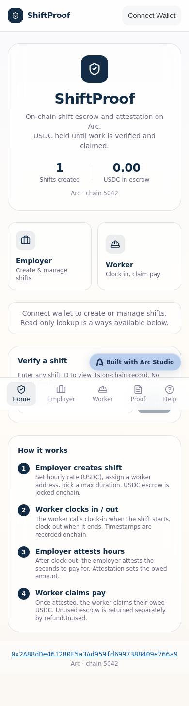
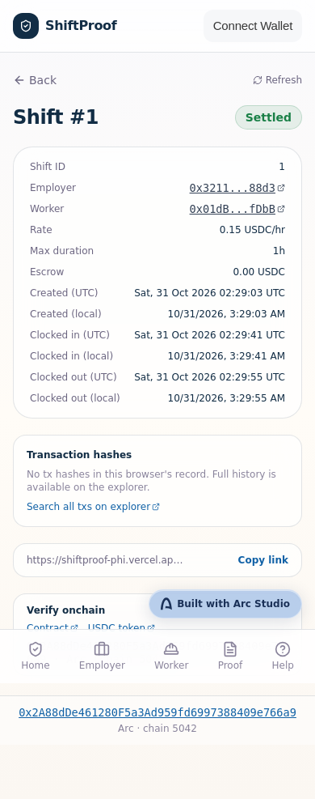
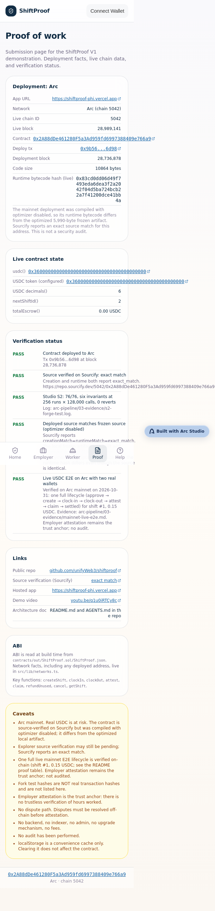
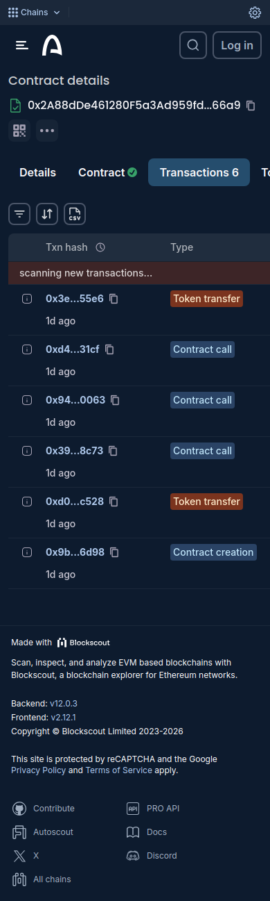
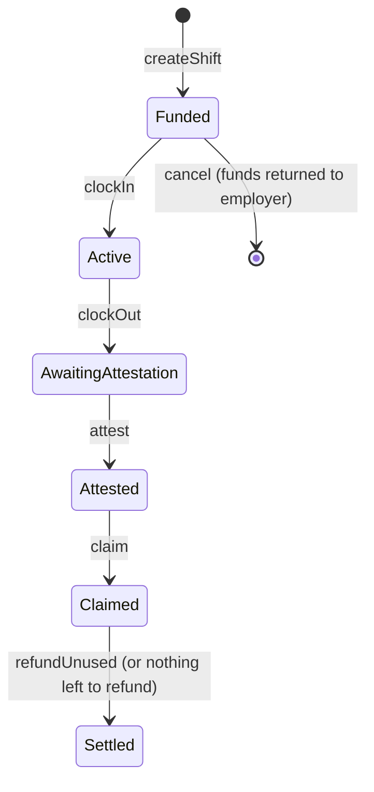
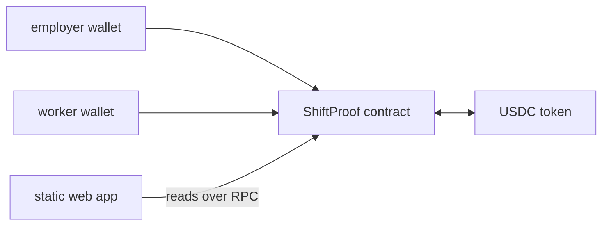

# ShiftProof

Pre-funded USDC settlement for hourly shifts on Arc.

  

ShiftProof is a smart contract for hourly shift settlement. An employer pre-funds USDC for a shift, the worker clocks in and out, the employer attests the hours, and the worker claims the attested amount. The contract enforces who can act and when. It does not prove that work was done: the employer's attestation is the trust anchor.

[live app](https://shiftproof-phi.vercel.app) | [demo video](https://youtu.be/q1u0iRTCy8c) | [contract on explorer](https://explorer.arc.io/address/0x2A88dDe461280F5a3Ad959fd6997388409e766a9) | [source on Sourcify](https://repo.sourcify.dev/5042/0x2A88dDe461280F5a3Ad959fd6997388409e766a9) | [arc studio project](https://studio.arc.io/app/35650d11-57a8-4743-8c23-a6bfe1a02f39) | [mainnet proof](#mainnet-proof)

start here: watch the [demo video](https://youtu.be/q1u0iRTCy8c), then open the live app, then shift 1, then the contract on the explorer.

Built for the Arc Microgrants hackathon (Built with Arc Studio).

## at a glance

| item | value |
|---|---|
| network | Arc mainnet, chain ID 5042 |
| contract | `0x2A88dDe461280F5a3Ad959fd6997388409e766a9` |
| deployment | block 28,736,878, tx [`0x9b56fa49…36d98`](https://explorer.arc.io/tx/0x9b56fa49c2c78b78ac24c7f4f154d4825194c6939b05f4e8086a8d5e10336d98) |
| token | USDC, `0x3600000000000000000000000000000000000000`, 6 decimals |
| source verification | exact match on Sourcify (creation and runtime) |
| compiler | solc 0.8.28, Cancun, optimizer off (see [verify it yourself](#verify-it-yourself)) |
| status | working prototype, unaudited |
| license | MIT |

## screens

| screenshot | caption |
|---|---|
|  | Home page, logged out: 1 shift created, 0.00 USDC in escrow, Arc chain 5042. |
|  | Shift #1, status Settled: rate 0.15 USDC per hour, 1 hour maximum, escrow 0.00 USDC. |
|  | Proof page: deployment facts, live contract state and the verification status list. |
|  | Contract page on explorer.arc.io, Transactions tab, six transactions listed. |

## the problem

Short hourly jobs have a timing gap. The worker does the work first and is paid later, and the amount depends on hours that both sides must agree on. When payment is late or the hours are disputed, the worker has little visibility and few options.

ShiftProof addresses one part of that gap. The money is committed before the shift starts, and release follows rules that both parties can read and check on a public chain. The intended scope is short engagements between parties who already agree on a rate and a maximum duration, such as temporary event staffing or one-off contractor shifts. ShiftProof is not a payroll system. It does not handle tax, worker classification or local labor rules.

## how it works

1. The employer creates a shift: worker address, hourly rate in USDC and maximum duration. The employer approves USDC and the contract locks the maximum amount.
2. The worker clocks in and clocks out. The contract records both times.
3. The employer attests the number of seconds to pay for, up to the maximum duration. This sets the amount owed.
4. The worker claims the attested amount.
5. Any unused amount is returned to the employer.



| role | can do |
|---|---|
| employer | create and fund a shift, attest hours, cancel before clock-in, refund unused funds |
| worker | clock in, clock out, claim the attested amount |
| any other address | read shift state |

Refunds always go to the employer address, whoever calls them. The exact rules are in [`app/contracts/ShiftProof.sol`](app/contracts/ShiftProof.sol).

## mainnet proof

One complete shift was run on Arc mainnet through the live app, using two wallets controlled by the builder. Every row can be opened on the explorer.

| step | sender | transaction | result |
|---|---|---|---|
| deploy contract | deployer | [`0x9b56fa49…36d98`](https://explorer.arc.io/tx/0x9b56fa49c2c78b78ac24c7f4f154d4825194c6939b05f4e8086a8d5e10336d98) | block 28,736,878 |
| approve USDC | employer | [`0x1d58499b…9e719`](https://explorer.arc.io/tx/0x1d58499b9f9c88d59b826fd37c59a1ca63fe39f99361b1fb252606439309e719) | exact allowance of 0.15 USDC |
| createShift | employer | [`0xd0fee562…3c528`](https://explorer.arc.io/tx/0xd0fee562f840cc303a02f11a2fe771b3a8f4537650d32f07b7cb5e7dd073c528) | 0.15 USDC locked, rate 0.15 USDC/hr, 1 hour maximum (2026-10-31 02:29 UTC) |
| clockIn | worker | [`0x3938a944…18c73`](https://explorer.arc.io/tx/0x3938a9440e6c1afb6a3588b1fdf5ca9c89338d37f98ab34c967a8ddd33518c73) | shift active |
| clockOut | worker | [`0x940951f1…50063`](https://explorer.arc.io/tx/0x940951f1e35dab64e13972ac6f980c9a478f064b2a55aedc230b7fc6efe50063) | awaiting attestation |
| attest | employer | [`0xd4f47eb0…31cf`](https://explorer.arc.io/tx/0xd4f47eb026827032ff39323e49a5eb6996c259e324f15d992bd3931c51cb31cf) | 3,600 seconds attested, 0.15 USDC owed |
| claim | worker | [`0x3e8011cf…055e6`](https://explorer.arc.io/tx/0x3e8011cfdaf40ca6510ba8f5cc3f060abdfffb68b4e3645eb886351476f055e6) | 0.15 USDC paid to the worker (2026-10-31 02:31 UTC) |

Final state: `nextShiftId` is 2 and `totalEscrow` is 0. Because the full amount was attested and claimed, nothing was left to refund. Refund and cancel are covered by the test suite and were not run on mainnet. The raw data is in [`arc-pipeline/03-evidence`](arc-pipeline/03-evidence).

## built with arc studio

| built in arc studio | done outside arc studio |
|---|---|
| the Solidity contract | mainnet deployment through Remix (Studio deploys to testnet only) |
| the Foundry test suite | the mainnet entry in `app/src/lib/networks.ts` |
| the React app: employer, worker, shift lookup, proof and help pages | text edits to this README and the proof page |
| the testnet deployment at [`0x39845ad2…41a6`](https://explorer.testnet.arc.io/address/0x39845ad25394ec0a6c15ebc5d8968d9c70bb41a6) on Arc Testnet (chain 5042002) | GitHub repository and Vercel hosting |
| a follow-up refactor: shared router fix and a single network configuration file | read-only collection of the on-chain evidence |

The recorded Studio run passed 76 of 76 tests, including six invariant properties (256 runs, 128,000 calls, no reverts). That run used the Studio compiler output with the optimizer on. It did not test the deployed bytecode.

## architecture

ShiftProof is one contract with no admin key, no backend and no indexer. The web app is static. It reads state over a public RPC and sends transactions through the user's wallet.



The app has five pages: home with a read-only shift lookup, employer, worker, proof and help. The proof page reads the chain live and shows the chain ID, latest block, contract code size, runtime hash, USDC address, `nextShiftId` and `totalEscrow`.

## verify it yourself

1. Open the [contract on the explorer](https://explorer.arc.io/address/0x2A88dDe461280F5a3Ad959fd6997388409e766a9) and check the six transactions listed above.
2. Open the Sourcify match and confirm the source is the one in this repository.
3. Call `usdc()`, `nextShiftId()` and `totalEscrow()` through the explorer or a public RPC (`https://rpc.mainnet.arc.io`).
4. Open the [live proof page](https://shiftproof-phi.vercel.app/proof).

**compiler difference.** The mainnet deployment was compiled in Remix with the optimizer off. The Studio artifact in this repository was compiled with the optimizer on (200 runs). The source is the same. The read-only verifier script in `arc-pipeline/scripts` compares the deployment with the Studio artifact, so it reports a mismatch by design.

| field | Studio artifact | mainnet deployment |
|---|---|---|
| compiler | solc 0.8.28 | solc 0.8.28 |
| EVM target | Cancun | Cancun |
| optimizer | on, 200 runs | off |
| runtime size | 5,990 bytes | 10,864 bytes |
| runtime keccak-256 | `0x843ef44664f6eb7bbbe95c213d6fd60b88d912b3810d087981ab69a94b90b1e5` | `0x83cd0dd06d49f7493eda6dea3f2a2042f04d5ba724bcb22a7f41200dce41bb4a` |

## limitations

- The employer's attestation is the trust anchor. The contract records that a worker clocked in and out. It does not show that work was done.
- There is no dispute path. If the employer attests too little, the worker has no on-chain remedy.
- The contract has not been audited and is immutable.
- The mainnet demo used two wallets controlled by the builder. No real employer or worker has used it.
- No legal or jurisdiction review has been done.
- The Studio tests were not re-run against the deployed optimizer-off bytecode.
- Refund and cancel were not exercised on mainnet.

## roadmap

Not built yet.

- a pilot with a real employer and workers
- a worker dispute path
- an independent audit
- a multi-shift interface

## run it locally

```bash
cd app
npm install
npm run dev
```

The app defaults to Arc Testnet. For a mainnet build:

```bash
VITE_NETWORK=mainnet npx vite build
```

## project layout

- `app/contracts/ShiftProof.sol`: the contract
- `app/src/lib/networks.ts`: network and deployment configuration
- `app/deployments.json`: testnet deployment record
- `arc-pipeline/03-evidence`: on-chain evidence
- `arc-pipeline/scripts`: read-only verifier script

## license and author

MIT. Built by unify, [@oxunify](https://x.com/oxunify).
